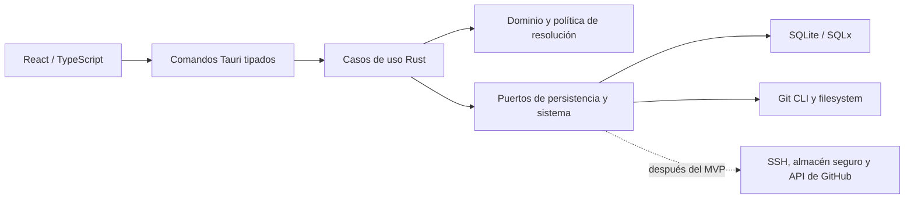

# Arquitectura de GitPilot

## Límites y dependencias

Monolito modular de escritorio. Tauri 2 aloja una interfaz local React 19, TypeScript y Vite. Tailwind y componentes seleccionados de shadcn/ui dan forma a la interfaz. Rust concentra dominio, operaciones y permisos. SQLite con SQLx persiste el estado local. Git CLI ejecuta las consultas y verifica las escrituras. Gitoxide se evalúa para lecturas puntuales con paridad demostrada. GitHub REST API entra como adaptador después del MVP.

| Capa | Responsabilidad |
| --- | --- |
| Presentación | Formularios, navegación, estado de consulta y progreso. Validación temprana con Zod donde aporte valor. Enlaces externos en navegador del sistema. |
| Borde IPC | DTOs tipados, validación Rust, códigos de error estables y datos de diagnóstico filtrados. Comandos orientados a casos de uso. |
| Aplicación | Identidades, escaneo, reglas, diagnóstico, planes y transacciones, settings, auditoría y flujos futuros de autenticación. |
| Dominio | Identidad, regla, repositorio, precedencia, conflicto y precondiciones. Pruebas deterministas independientes de Git, SQLite y UI. |
| Infraestructura | SQLx y migraciones, Git CLI, filesystem y journal, paths por SO, almacenamiento seguro y HTTP. |

## Contratos iniciales

- Identidades y reglas tienen versiones. La capa de aplicación mantiene en borrador los cambios que afecten una configuración aplicada hasta que el usuario decida materializarlos. Un repositorio puede presentar un borrador distinto del último estado verificado.
- Comandos previstos por capacidad. CRUD de identidades y reglas, registro de raíces, inicio/cancelación de escaneo, consulta de diagnóstico, creación de plan, aplicación y restauración. El frontend envía IDs de recursos y una referencia de plan. Rust resuelve los destinos y los revalida.
- El escaneo es un trabajo con ID. Devuelve progreso, resultados parciales y motivo de cancelación o error. Si dos escaneos concurren, la persistencia comprueba que la revisión de la raíz siga vigente antes de publicar resultados.
- Aplicar y restaurar son trabajos de escritura serializados por destinos. Un resultado indica archivos afectados, verificación y estado de recuperación. Las operaciones del sistema se coordinan fuera del hilo de interfaz.
- Usar errores de dominio distinguibles como Git no disponible, ruta inaccesible, repositorio no confiable, configuración incompatible, plan vencido y recuperación pendiente. Entregar detalles seguros y una acción contextual.
- Usar una sesión de configuración de Git representativa del usuario. El backend identifica Git y su entorno de ejecución, filtra variables peligrosas y explica los límites cuando otro editor o terminal usa configuración o variables distintas.

## Estructura prevista

- `apps/desktop/src/` para shell, componentes comunes, módulos por flujo y adaptador IPC.
- `apps/desktop/src-tauri/` para comandos, dominio, aplicación, infraestructura, capacidades, migraciones y pruebas.
- `crates/` cuando exista una responsabilidad reutilizable con una frontera estable. Empezar con módulos Rust dentro de la aplicación.
- `docs/`, `.github/workflows/` y `scripts/` para especificaciones, CI y utilidades compartidas. Configuración de asistentes e índices solo locales.

Introducir TanStack Query para caché de consultas y Zustand para estado UI compartido cuando los flujos lo requieran. Usar módulos tipados del frontend y evitar que la caché de UI decida el estado efectivo de Git. Consultar el [modelo de datos](DATABASE.md) y los [controles de seguridad](../security/SECURITY.md).
